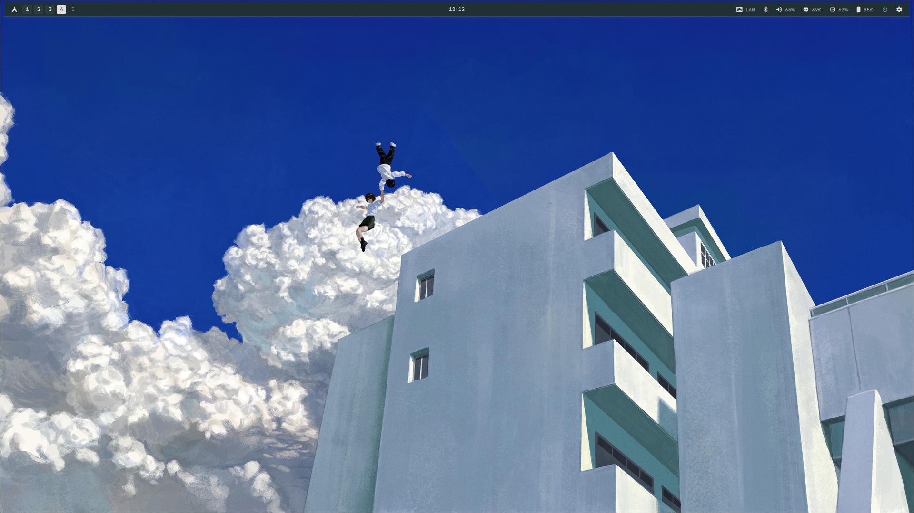
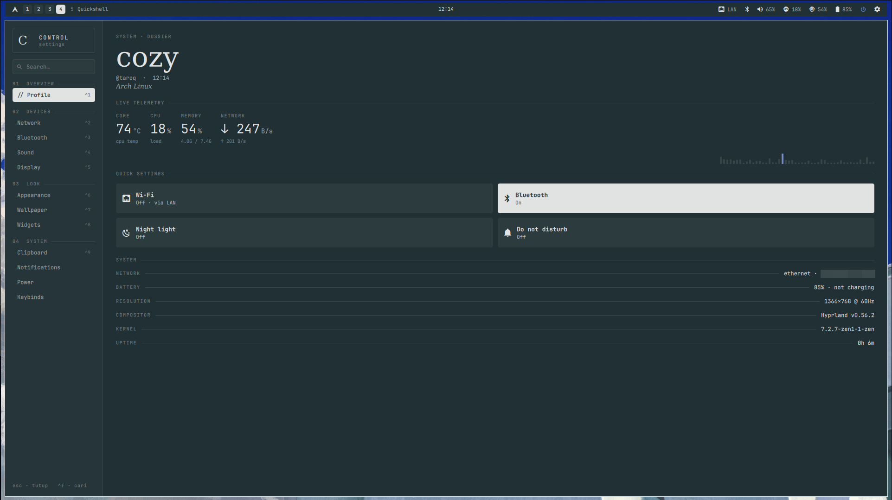

# dotfiles


My Arch + Hyprland rice. Pick a wallpaper and pywal recolors pretty much everything: the bar, the control center, kitty, rofi, Discord, Spotify, cava, VSCodium.

The shell (bar, control center, notifications, overview, desktop widgets) is my own Quickshell config, [My Shell](https://github.com/Clarity69/My-Shell). It lives here as a submodule under `config/quickshell/shell`.




## What's in here

| | |
| :--- | :--- |
| Window manager | Hyprland, hyprlock, hyprsunset |
| Shell | Quickshell ([My Shell](https://github.com/Clarity69/My-Shell)) for the bar, control center, notifications and widgets |
| Wallpaper | awww + `wallset-backend`, picker is hyprquickpaper |
| Colors | pywal, with templates in `config/wal/templates` |
| Terminal | kitty |
| Launcher | rofi |
| Extras | Spicetify, Vencord theme, Waybar layouts (old bar, still works) |

```
config/      everything that goes into ~/.config
bin/         scripts that go into ~/.local/bin (wallset, wallset-backend)
Wallpaper/   the wallpapers I use
dots.list    what gets tracked, one path per line
install.sh   symlinks the repo onto a fresh system
sync.sh      copies my current configs back into the repo
```

## Install

```sh
git clone --recursive https://github.com/Clarity69/dotfiles.git ~/dotfiles
cd ~/dotfiles
./install.sh --deps     # leave out --deps if you already have the packages
```

Anything already in `~/.config` gets moved to `~/dotfiles_backup_<date>` before it is replaced, so nothing is lost. Run `./install.sh -n` first to see what it would touch.

Then set a wallpaper once so pywal has colors to work with:

```sh
wallset-backend ~/Pictures/Wallpaper/<some image>
```

## Keeping it updated

I edit configs in place under `~/.config`, then pull them back into the repo:

```sh
cd ~/dotfiles
./sync.sh -n    # preview
./sync.sh
git add -A && git commit -m "sync" && git push
```

`sync.sh` skips `.git`, backups and `*.bak` files, and leaves pywal symlinks pointing at `~/.cache/wal` alone. For My Shell it pins the submodule to whatever commit is checked out in `~/.config/quickshell/shell`, so push that repo first.

To track something new, add a line to `dots.list` (for example `config/fastfetch`) and run `sync.sh`.

## Keybinds
 
`SUPER` is the main key.
 
| Keys | Does |
| :--- | :--- |
| `SUPER + Q` | Terminal (kitty) |
| `SUPER + R` | App launcher (rofi) |
| `SUPER + E` | File manager (nautilus) |
| `SUPER + C` | Close window |
| `SUPER + M` | Lock screen (hyprlock) |
| `SUPER + Escape` | Power menu (wlogout) |
| `SUPER + ALT + V` | Toggle floating |
| `SUPER + P` | Pseudo tile |
| `SUPER + J` | Toggle split |
| `SUPER + arrows` | Move focus |
| `SUPER + 1-0` | Switch workspace |
| `SUPER + SHIFT + 1-0` | Move window to workspace |
| `SUPER + scroll` | Cycle workspaces |
| `SUPER + S` | Scratchpad |
| `SUPER + SHIFT + S` | Send window to scratchpad |
| `SUPER + LMB / RMB drag` | Move / resize window |
 
Shell and theming:
 
| Keys | Does |
| :--- | :--- |
| `SUPER + TAB` | Workspace overview |
| `SUPER + V` | Clipboard history (opens in the control center) |
| `SUPER + K` | Wallpaper picker (hyprquickpaper) |
| `SUPER + ALT + B` | Switch bar layout |
| `SUPER + W` | Wi-Fi menu (rofi) |
| `SUPER + B` | Bluetooth menu (rofi) |
| `SUPER + L` | Launch Waybar (old bar) |
 
Screenshots land in `~/Pictures/ss` and get copied to the clipboard:
 
| Keys | Does |
| :--- | :--- |
| `Print` | Select an area |
| `SUPER + Print` | Whole screen |
 
Volume, mic, brightness and media keys work as you'd expect (wpctl, brightnessctl, playerctl).

The rest are in `config/hypr/keybinds.conf`.
